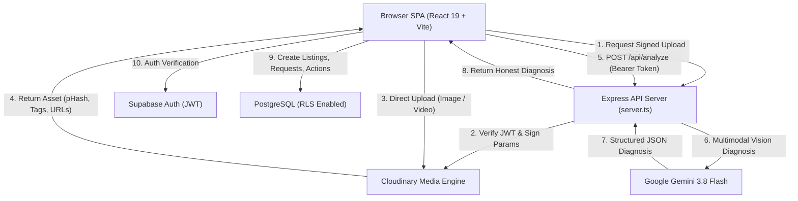

# SecondLife AI 🌱
> **Smart Choices. Longer Lives.**  
> A circular economy decision engine and neighborhood sharing platform that prevents landfill waste, facilitates local borrowing and donations, and diagnoses repairable household items with multimodal AI.

---

## 📸 Screenshots & Previews

| Multimodal AI Diagnostics | Neighborhood Circle | Circular Impact Tracking |
| :---: | :---: | :---: |
| *[Screenshot Placeholder: Item Diagnosis & Maintenance Tips]* | *[Screenshot Placeholder: Community Feed with Borrow/Donate]* | *[Screenshot Placeholder: Verified Carbon & Waste Diverted]* |

---

## ⚡ What SecondLife AI Does

1. **Multimodal Item Diagnostics:** Snap a photo of any broken, worn, or unused item. SecondLife AI provides an honest circular estimate—distinguishing working items that need routine care (`maintain`) from repairable items (`repair`), lending candidates (`borrow`), or donation candidates (`donate`).
2. **Honest AI Labeling:** Clearly distinguishes live Gemini Vision diagnoses (`AI-assisted estimate`) from offline diagnostic heuristics (`Offline estimate, AI unavailable`), with visible preliminary disclaimers.
3. **Neighborhood Circular Circle:** List and discover tools, appliances, books, gear, and furniture in your local area for borrowing or donation.
4. **Duplicate Detection via Perceptual Hash:** Computes 64-bit perceptual hashes (`pHash`) on item photos and evaluates Hamming distance to prevent duplicate listings.
5. **Real-Data Impact Ledger:** Every kg of waste prevented, kg of CO2 diverted, and rupee saved is calculated from verified actions in Supabase—no hardcoded or seeded numbers.
6. **Community Trust & Safety:** Verified badges (confirmed email & profile), calculated trust scores (0-100), anonymous listing reporting, in-app safety tips, and privacy-preserving approximate locations.
7. **Full Data Control:** Self-service account and data deletion removes all listings, requests, reviews, and profile data from database tables in one click.

---

## 🛠 Tech Stack

- **Frontend:** React 19, TypeScript, Tailwind CSS v4, Lucide React, Recharts (Area charts), Motion (micro-animations).
- **Backend Server:** Node.js, Express, TypeScript (`tsx`), Helmet (security headers), CORS, Express Rate Limit, Zod (schema validation).
- **AI Engine:** Google Gemini 3.8 Flash Vision via official `@google/genai` SDK with strict JSON schema constraints.
- **Media Pipeline:** Cloudinary Node SDK & Upload API (server-signed uploads, background removal, smart gravity cropping, perceptual hashing, moderation, auto-tagging, video delivery).
- **Database & Auth:** Supabase (PostgreSQL with Row Level Security, email auth, Google OAuth, stored procedures).

---

## 🏛 Architecture Diagram



For comprehensive data flow documentation, see [docs/ARCHITECTURE.md](docs/ARCHITECTURE.md).

---

## ☁️ Cloudinary Features Used & Why

| Feature | Where Used | Why It's Essential |
| :--- | :--- | :--- |
| **Server-Signed Uploads** | Listing & Analysis uploads | Protects `CLOUDINARY_API_SECRET` server-side while uploading directly from client into user-scoped folders (`secondlife/users/{userId}`). |
| **Perceptual Hashing (`phash`)** | Duplicate listing detection | Generates a 64-bit visual hash on upload; compared using Hamming distance ($\le 8$) to prevent spam and duplicate listings. |
| **Automated Auto-Tagging** | Image ingestion | Automatically identifies item types and materials (e.g. toaster, drill, denim) to enrich search and assist Gemini prompts. |
| **Automated Moderation** | Server upload pipeline | Screens uploaded images before listing creation; immediately destroys and rejects inappropriate media. |
| **AI Background Removal (`e_background_removal`)** | Item cutouts & cards | Isolates items from messy indoor backgrounds into clean transparent product cutouts. |
| **Damage Focus Crop (`c_crop,g_auto,z_1.7`)** | Diagnostics detail view | Automatically detects the item center and crops in closely onto wear/damage regions. |
| **Responsive `f_auto,q_auto` & SrcSets** | Community feed & thumbnails | Delivers modern formats (AVIF/WebP) with ~82% bandwidth savings compared to uncompressed originals. |
| **Condition Videos (`resource_type: video`)** | Working condition clips | Streams short 15-second operational video clips with auto-generated poster frames (`so_0`). |
| **LQIP Placeholders** | Lazy loading images | Provides instant blurred thumbnail placeholders for smooth perceived performance on 3G/mobile networks. |

---

## ⚙️ Local Setup Guide

### 1. Prerequisites
- **Node.js** v18+ and **npm** v9+
- A free **Supabase** account ([supabase.com](https://supabase.com))
- A free **Cloudinary** account ([cloudinary.com](https://cloudinary.com))
- A free **Google AI Studio** Gemini API Key ([aistudio.google.com](https://aistudio.google.com))

### 2. Install Dependencies
```bash
git clone <repository-url> secondlife-ai
cd secondlife-ai
npm install
```

### 3. Environment Variables
Copy the template file to `.env`:
```bash
cp .env.example .env
```

Set the following environment variable names (keep secrets confidential):

| Variable Name | Environment | Sensitivity | Description |
| :--- | :--- | :--- | :--- |
| `PORT` | Server | Public / Config | Server port (default: `3000` or `10000` on Render) |
| `NODE_ENV` | Server | Public / Config | `development` or `production` |
| `ALLOWED_ORIGIN` | Server | Public / Config | Allowed CORS origin (e.g. `http://localhost:3000` or production URL) |
| `GEMINI_API_KEY` | Server | **SECRET** | Google Gemini Vision API key |
| `CLOUDINARY_CLOUD_NAME` | Server | Public / Config | Cloudinary cloud identifier |
| `CLOUDINARY_API_KEY` | Server | Public / Config | Cloudinary API Key |
| `CLOUDINARY_API_SECRET` | Server | **SECRET** | Cloudinary API Secret (strictly server-side) |
| `VITE_SUPABASE_URL` | Client & Server | Public Client Key | Supabase Project URL |
| `VITE_SUPABASE_ANON_KEY` | Client & Server | Public Client Key | Supabase Anonymous Public API key |

> ⚠️ **Security Notice:** Never prefix `CLOUDINARY_API_SECRET` or `GEMINI_API_KEY` with `VITE_`. They must remain strictly server-side.

### 4. Supabase Database Migrations
Run the migration scripts in the **Supabase Dashboard -> SQL Editor** in the following order:

1. `supabase/migrations/20261025_init_schema.sql` — Core tables (`profiles`, `listings`, `requests`, `analyses`, `actions`, `reviews`), RLS, and triggers.
2. `supabase/migrations/20261025_phase3b_request_flow.sql` — Request statuses and handover tracking.
3. `supabase/migrations/20261025_phase3c_reviews_and_trust.sql` — Trust score functions, reviews, and reports table.
4. `supabase/migrations/20261025_phase4_real_impact.sql` — Real impact calculations, `actions` table schema, and leaderboard views.
5. `supabase/migrations/20261025_phase5a_cloudinary.sql` — Bandwidth metrics and signed upload columns.
6. `supabase/migrations/20261025_phase5b_cloudinary_depth.sql` — Perceptual hash (`phash`) and video public ID columns.
7. `supabase/migrations/20261025_phase6a_security_hardening.sql` — RLS privacy hardening (`actions` and `reports` restrictions, masked leaderboard).
8. `supabase/migrations/20261025_phase6b_account_deletion.sql` — Secure self-service account deletion function.

### 5. Running Locally
Start the development server:
```bash
npm run dev
```
Open [http://localhost:3000](http://localhost:3000) in your browser.

---

## 🚀 Deployment Guide (Render)

SecondLife AI is configured to build and serve both the frontend SPA and Express API from a single Node process.

### Step 1: Connect Repository to Render
1. Go to [Render Dashboard](https://dashboard.render.com/) and click **New + -> Web Service**.
2. Connect your GitHub/GitLab repository.
3. Render will auto-detect `render.yaml`. If configuring manually:
   - **Environment:** `Node`
   - **Build Command:** `npm install && npm run build`
   - **Start Command:** `npm start`
   - **Plan:** Free or Starter

### Step 2: Configure Environment Variables in Render
In the **Environment** tab of your Render service, add the required production variables:
- `NODE_ENV`: `production`
- `ALLOWED_ORIGIN`: Your deployed Render URL (e.g. `https://secondlife-ai.onrender.com`)
- `GEMINI_API_KEY`: Your Google AI Studio key
- `CLOUDINARY_CLOUD_NAME`: Your Cloudinary cloud name
- `CLOUDINARY_API_KEY`: Your Cloudinary API key
- `CLOUDINARY_API_SECRET`: Your Cloudinary API secret
- `VITE_SUPABASE_URL`: Your Supabase project URL
- `VITE_SUPABASE_ANON_KEY`: Your Supabase anon key

### Step 3: Update Supabase URL Configuration
In your **Supabase Dashboard -> Authentication -> URL Configuration**:
1. Set **Site URL** to your production URL (`https://your-app.onrender.com`).
2. Add your production URL to **Redirect URLs** (`https://your-app.onrender.com/**`).

---

## 📋 Post-Deployment Smoke Test Checklist

- [ ] **Health Endpoint:** Visit `https://your-app.onrender.com/api/health` — confirm HTTP 200 with `status: "healthy"` and no secrets exposed.
- [ ] **Homepage & Navigation:** Verify homepage loads without console errors and metrics banner displays collective totals.
- [ ] **Authentication:** Test sign-in and sign-up with email and Google OAuth. Ensure consent checkbox is required for sign-up.
- [ ] **Multimodal Item Analysis:** Upload an item photo on Home/Analyze screen.
  - Verify signed upload to Cloudinary succeeds.
  - Verify honest badge displays (`AI-assisted estimate` or `Offline estimate, AI unavailable`).
  - Verify disclaimer is visible at the bottom.
- [ ] **Community Listing:** Publish an item for borrowing or donation with a photo.
  - Verify photo appears with Cloudinary responsive transformations.
  - Verify duplicate check runs if attempting to upload the same image twice.
- [ ] **Exchange Request Flow:** Submit a request for an item using a test account. Check that it appears in the owner's **Exchange Inbox**.
- [ ] **Impact Dashboard:** Check that the Impact tab displays real zeros for new users and accumulates real kg waste and CO2 upon completing an action.
- [ ] **Account Deletion:** Open Profile modal -> Danger Zone -> Confirm Delete. Verify user data and active listings are purged from the database.
- [ ] **Mobile Responsiveness:** Inspect at 360px width in DevTools — confirm sticky Sign Out button and navigation bar are fully functional.

---

## 🔮 Limitations and Future Work

1. **ScrapMatch Marketplace:** Direct automated matching of non-repairable electronic components and scrap metal with local certified recyclers and e-waste collection centers.
2. **Verified Technician Directory:** Live geo-located directory of local repair technicians, complete with booking calendar, direct quote requests, and verified customer testimonials.
3. **Web Push Notifications:** Native Web Push notifications for instantaneous borrower requests, handover approvals, and return reminders.
4. **In-App Encrypted Chat:** Ephemeral, end-to-end messaging between neighbors during active handovers to coordinate pick-up times without sharing third-party messenger handles.
5. **Offline Action Queuing:** Service worker background sync to queue analysis and listings offline, synchronizing automatically when reconnecting to Wi-Fi.

---

## 📂 Project Structure

```
secondlife-ai/
├── docs/
│   └── ARCHITECTURE.md          # Complete data flow & architecture specification
├── src/
│   ├── components/              # UI Modals, Badges, Sliders & Status bars
│   │   ├── AuthModal.tsx        # Authentication modal with legal consent
│   │   ├── ErrorBoundary.tsx    # Global & inline React error boundaries
│   │   ├── Footer.tsx           # Footer with links to Cloudinary & Legal pages
│   │   ├── LegalModal.tsx       # Plain-language Privacy Policy & Terms of Service
│   │   ├── NetworkStatusBar.tsx # Offline detection & reconnect indicator
│   │   ├── ProfileModal.tsx     # Profile editing, trust score & account deletion
│   │   ├── RequestListingModal.tsx # Borrow/donate request with safety tips
│   │   └── ...
│   ├── config/                  # Cloudinary, Supabase, impact & badge configs
│   ├── context/
│   │   └── AppContext.tsx       # Core application state & API integrations
│   ├── screens/                 # Full-page responsive screen views
│   │   ├── HomeScreen.tsx       # Circular hero, upload dropzone & community stats
│   │   ├── AnalyzeScreen.tsx    # Multimodal diagnostic results & honest labels
│   │   ├── CommunityScreen.tsx  # Neighborhood circle feed & filter bar
│   │   ├── InboxScreen.tsx      # Exchange coordination & handover tracking
│   │   └── ImpactScreen.tsx     # Real environmental metrics & opted-in leaderboard
│   ├── utils/                   # Trust score & calculation algorithms
│   ├── App.tsx                  # Root component with routing & error boundaries
│   └── main.tsx                 # Client application entry point
├── supabase/
│   └── migrations/              # Ordered PostgreSQL migrations (Phases 1-6B)
├── server.ts                    # Production Express server (Helmet, CORS, Rate Limit, Zod)
├── render.yaml                  # Render deployment configuration
├── .env.example                 # Template for required environment variables
└── package.json                 # Scripts and production dependencies
```

---

## 📄 License & Legal Notice

This project is open-source under the MIT License. The Privacy Policy and Terms of Service included in this application are prototype-stage drafts and must undergo professional legal counsel review prior to commercial deployment.
