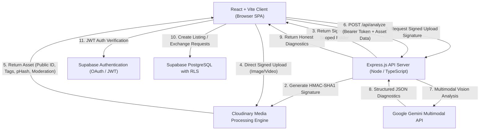

# SecondLife AI — System Architecture & Data Flow

This document details the architecture, data pipeline, and security topology of **SecondLife AI**, a circular economy decision engine and neighborhood sharing platform.

---

## 1. High-Level Architecture Overview

SecondLife AI follows a secure client-server model designed for multimodal AI diagnostics, media processing, and privacy-preserving neighborhood exchanges:

---

## 2. End-to-End Circular Data Flow

### Step 1: Image & Media Ingestion
- The user uploads an item photo or records an optional short condition video (up to 15s / 30MB).
- The client enforces client-side file format checks (`image/jpeg`, `image/png`, `image/webp`, `image/heic`, `video/mp4`, `video/quicktime`) and file size limits (10MB for images, 30MB for videos).

### Step 2: Server-Signed Cloudinary Upload
- To prevent exposing the `CLOUDINARY_API_SECRET` to the browser, the client calls `POST /api/cloudinary/signature` with an `Authorization: Bearer <token>` header.
- The Express server verifies the user's Supabase session and signs the upload parameters using the Cloudinary Node SDK:
  - Scoped user folder: `secondlife/users/{userId}`
  - Moderation add-on: `manual` / configured provider
  - Perceptual hash: `phash=true` (for images)
- The client receives the signature and uploads directly to Cloudinary's secure upload API, avoiding server memory bottlenecks.

### Step 3: Cloudinary Automated Processing Pipeline
Cloudinary processes the uploaded asset on ingestion:
1. **Perceptual Hashing (pHash):** Computes a 64-bit perceptual hash for duplicate photo detection.
2. **Auto-Tagging:** Runs automatic categorization and tagging (e.g. Google Auto-Tagging) to identify item materials, categories, and brands.
3. **Automated Moderation:** Evaluates the asset against safety guidelines. If rejected, the listing flow is aborted and the asset is scheduled for deletion.
4. **On-the-Fly Dynamic Transformations:**
   - Cutout / Background Removal: `e_background_removal,f_auto,q_auto`
   - Smart Gravity Thumbnail: `c_fill,g_auto,w_400,h_400,f_auto,q_auto`
   - Damage Zoom Focus: `c_crop,g_auto,w_500,h_500,z_1.7,f_auto,q_auto`
   - Branded Impact Badge: Text overlays composited dynamically.
   - Low-Quality Image Placeholder (LQIP): Micro blurred preview (`w_30,e_blur:1000,q_auto:eco`).

### Step 4: Server-Side Gemini Multimodal Analysis
- The client sends the Cloudinary media URL, user description, and detected tags to `POST /api/analyze`.
- The Express server enforces rate limiting (30 req / 15m) and validates the body schema using **Zod**.
- The server constructs an expert circular-economy prompt and invokes **Gemini** with a strict JSON schema:
  - **Honest Diagnosis:** If no defect is described and the photo shows an intact item, Gemini explicitly returns `likely_issue: "No fault detected"`, `condition: "good"`, and `recommended_action: "maintain"` with preventative maintenance tips.
  - **Evidence-Based Confidence:** Confidence reflects observable damage (50-99%).
  - **Impact Estimates:** Item-specific `estimated_waste_saved_kg`, `estimated_co2_saved_kg`, and repair vs replacement cost ranges in INR.
- If Gemini is unreachable or rate-limited, the server automatically returns a realistic diagnostic fallback labeled **`Offline estimate, AI unavailable`**.

### Step 5: Duplicate Detection (pHash & Hamming Distance)
- Before publishing a listing, the client sends the asset's pHash to `POST /api/cloudinary/check-duplicate`.
- The server compares the 64-bit hexadecimal pHash against active community listings using bitwise XOR Hamming distance:
  $$\text{Distance} \le 8 \implies \text{Near-duplicate photo}$$
- If a match is found, the user is warned with a link to the existing listing.

### Step 6: Community Sharing Lifecycle
1. **Listing Creation:** Logged-in users list items for `borrow` or `donate`. Listings store owner ID, category, condition, tags, Cloudinary public IDs, and pHash.
2. **Exchange Request:** A neighbor submits a borrow/claim request with duration and message.
3. **Handover Coordination:** The owner accepts/declines. Handover is tracked from `pending` -> `accepted` -> `handed_over` -> `completed` / `returned`.
4. **Trust & Reviews:** Both participants leave a 1-5 star review with feedback. Trust score (0-100) updates based on profile completeness, ratings, completed exchanges, and photo quality.

### Step 7: Real Environmental Impact Accumulation
- When an exchange or repair completes, a row is inserted into `public.actions` with real metrics (`waste_kg`, `co2_kg`, `money_saved_inr`, `type`, `estimate_source`).
- No stats are hardcoded:
  - User impact totals reflect real sums from `public.actions` where `user_id = auth.uid()`.
  - Community collective impact totals are computed dynamically across opted-in neighbors.
  - Public leaderboard ranks members who opted in (`show_on_leaderboard = true`), masking surnames and displaying approximate neighborhoods.

---

## 3. Security, Authorization & Privacy Topology

| Layer | Mechanism | Protection |
| :--- | :--- | :--- |
| **API Gatekeeper** | Helmet Security Headers | Mitigates clickjacking (`X-Frame-Options`), MIME sniffing, and cross-site leaks. |
| **CORS** | Strict Origin Whitelisting | Enforces `process.env.ALLOWED_ORIGIN`. |
| **Rate Limiting** | `express-rate-limit` | General (120/15m), AI analysis (30/15m), Uploads (45/15m) keyed by user ID or IP. |
| **Body Validation** | Zod Schemas + 15MB limit | Validates types, lengths, string bounds, and prevents JSON memory exhaustion. |
| **Auth Verification** | Server-Side Supabase Token Check | Endpoints that mutate data or spend API quotas require a valid JWT via `supabase.auth.getUser()`. |
| **Secret Isolation** | Zero Browser Secret Leakage | `CLOUDINARY_API_SECRET`, `GEMINI_API_KEY`, and Supabase service keys exist only on the server. |
| **Database Security**| Postgres Row Level Security (RLS)| `actions`, `reports`, `listings`, `requests`, and `profiles` enforce strict row-level authorization. |
| **Account Deletion** | Self-Service Purge Function | `delete_user_account_data()` removes all associated user rows and Cloudinary assets without exposing admin keys. |
| **Front Resilience** | React Error Boundaries | Global and per-route boundaries prevent white-screen crashes; offline detection alerts users when connection drops. |
